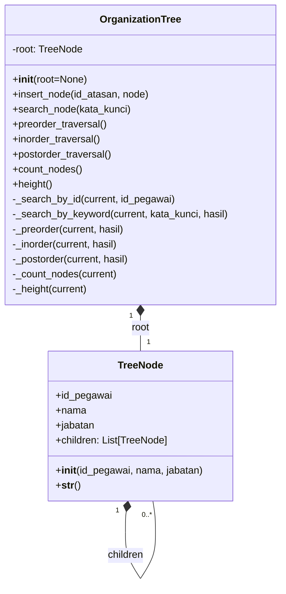

# Class Diagram Proyek 1b

Diagram berikut menggambarkan class yang digunakan pada implementasi Python.

Keterangan: tanda `+` menunjukkan method/atribut publik dan tanda `-` menunjukkan bagian internal (helper/private) pada rancangan. Satu `OrganizationTree` memiliki satu root, sedangkan setiap `TreeNode` dapat memiliki nol atau lebih child.
