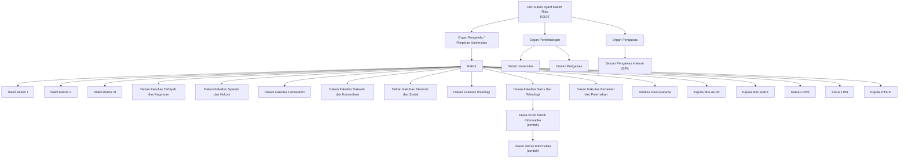

# Struktur General Tree UIN Sultan Syarif Kasim Riau

## Cakupan dan prinsip model

Tree ini adalah purwarupa ringkas, bukan salinan lengkap seluruh bagan jabatan UIN Suska Riau. Root mewakili institusi UIN Suska Riau. Tiga kelompok organisasi di bawah Root memisahkan Organ Pengelola/Pimpinan Universitas, Organ Pertimbangan, dan Organ Pengawas.

Pemisahan ini penting agar Senat Universitas dan Dewan Pengawas tidak digambarkan sebagai bawahan operasional Rektor. Rektor berada di dalam kelompok Organ Pengelola. Delapan fakultas, Pascasarjana, dua biro, dua lembaga, dan satu UPT PTIPD ditampilkan sebagai unit pada cabang pengelola. Cabang Fakultas Sains dan Teknologi diperinci satu tingkat sampai Ketua Program Studi Teknik Informatika dan Dosen sebagai contoh hubungan akademik sesuai skenario tugas.

Nama orang yang diawali kata "Nama" merupakan placeholder, bukan nama pejabat aktual. Hubungan Parent–Child pada diagram adalah penyederhanaan untuk kebutuhan purwarupa General Tree; koordinasi dan pertanggungjawaban resmi antarunit dapat memiliki detail yang lebih kompleks.

## Diagram

## Jumlah node dan bentuk Tree

- Total: 27 node.
- Tinggi: 5 edge.
- Jumlah level: 6.
- Jumlah node per level: 1, 3, 4, 17, 1, 1.
- Cabang terdalam: UIN Suska → Organ Pengelola → Rektor → Dekan FST → Ketua Prodi Teknik Informatika → Dosen.

Bentuk Tree lebar dengan satu cabang yang lebih dalam. Ini bukan Binary Search Tree, tidak memiliki aturan pengurutan key, dan tidak menjamin pencarian O(log n). Pencarian nama/jabatan tetap O(n) pada kasus terburuk.

## Rujukan

1. UIN Suska Riau, *Rencana Strategis 2025–2029*, khususnya bagian 3.4.1 Organisasi, halaman dokumen 32–36: https://www.uin-suska.ac.id/wp-content/uploads/2026/03/Renstra_UIN_Suska_2025-2029_FINAL.pdf
2. UIN Suska Riau, Unit Kerja: https://www.uin-suska.ac.id/profil/unit-kerja
3. UIN Suska Riau, PTIPD: https://www.uin-suska.ac.id/unit-pelaksana-teknis/pusat-teknologi-informasi-dan-pangkalan-data/
