# Struktur General Tree Organisasi FST

Root pada struktur ini adalah Dekan FST. Judul kelompok PROGRAM STUDI dan LABORATORIUM hanya berfungsi sebagai pengelompokan visual pada bagan, bukan node tambahan. Setiap Program Studi dimodelkan sebagai node dengan dua child: Ketua Prodi dan Sekretaris Prodi. Tujuh Kepala Laboratorium dimodelkan sebagai child Dekan.

```mermaid
flowchart TB
    D["ORG001 — DEKAN FST"]

    D --> WD1["ORG002 — Wakil Dekan I"]
    D --> WD2["ORG003 — Wakil Dekan II"]
    D --> WD3["ORG004 — Wakil Dekan III"]
    D --> TU["ORG005 — Kepala Bagian Tata Usaha"]
    TU --> KJ["ORG006 — Kelompok Jabatan Fungsional dan Pelaksana"]

    subgraph PRODI["PROGRAM STUDI"]
      direction TB
      TI["ORG007 — Teknik Informatika"] --> TIK["ORG008 — Ketua Prodi"]
      TI --> TIS["ORG009 — Sekretaris Prodi"]
      TIND["ORG010 — Teknik Industri"] --> TINDK["ORG011 — Ketua Prodi"]
      TIND --> TINDS["ORG012 — Sekretaris Prodi"]
      SI["ORG013 — Sistem Informasi"] --> SIK["ORG014 — Ketua Prodi"]
      SI --> SIS["ORG015 — Sekretaris Prodi"]
      MAT["ORG016 — Matematika"] --> MATK["ORG017 — Ketua Prodi"]
      MAT --> MATS["ORG018 — Sekretaris Prodi"]
      TE["ORG019 — Teknik Elektro"] --> TEK["ORG020 — Ketua Prodi"]
      TE --> TES["ORG021 — Sekretaris Prodi"]
      MTE["ORG022 — Magister Teknik Elektro"] --> MTEK["ORG023 — Ketua Prodi"]
      MTE --> MTES["ORG024 — Sekretaris Prodi"]
    end

    D --> TI
    D --> TIND
    D --> SI
    D --> MAT
    D --> TE
    D --> MTE

    subgraph LAB["KEPALA LABORATORIUM"]
      direction TB
      L1["ORG025 — Pengembangan Aplikasi"]
      L2["ORG026 — Pengembangan Riset"]
      L3["ORG027 — Teknik Industri"]
      L4["ORG028 — Sistem Informasi"]
      L5["ORG029 — Matematika"]
      L6["ORG030 — Telekomunikasi dan Elektronika"]
      L7["ORG031 — Komputer dan Energi"]
    end

    D --> L1
    D --> L2
    D --> L3
    D --> L4
    D --> L5
    D --> L6
    D --> L7
```

Jumlah keseluruhan: 31 node. Tinggi tree: 2 edge atau 3 level.
